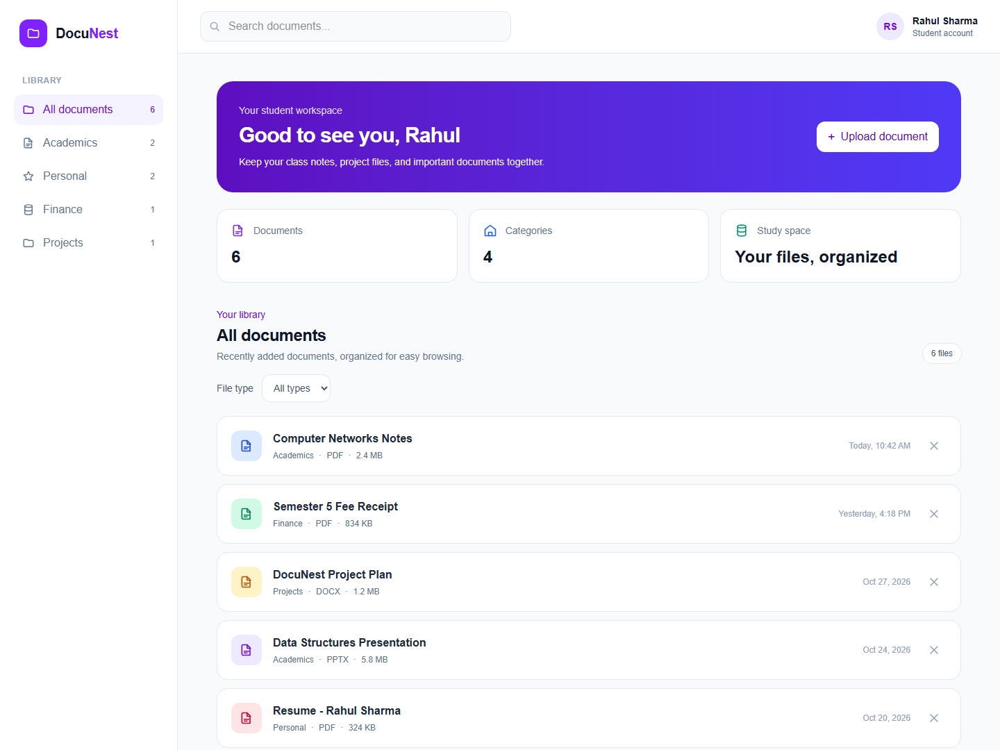
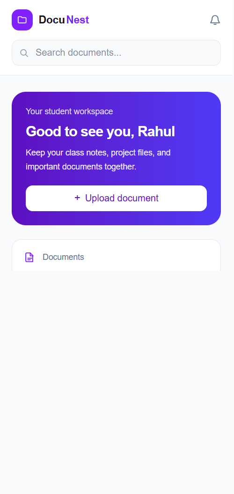

# DocuNest — Student Document Manager

DocuNest is a student document dashboard built with JavaScript, Next.js, React,
and Tailwind CSS.

## Requirements

- Node.js 20.9 or newer
- npm

## Set up and run

```bash
npm ci
npm run dev
```

Open [http://localhost:3000](http://localhost:3000).

For a production build, run `npm run build` and then `npm start`.

## Features

- Browse and remove sample documents organized into categories.
- Search by document name, category, or file type.
- Filter by category and file type; clear all filters from the empty state.
- Upload PDF, DOCX, PPTX, and XLSX files with a custom name and category.
- Open uploaded files in a new browser tab when the browser supports the format.
- Use the responsive dashboard on desktop and mobile screens.

Uploads are kept in browser memory only. They are lost when the page is
refreshed or closed; this MVP does not upload files to a server or save them to
GitHub.

## Screenshots





## Project structure

```text
app/
  globals.css
  layout.js
  page.js
components/
  dashboard/
    dashboard.js
    category-filter.js
    data.js
    document-card.js
    document-context.js
    icons.js
    search-bar.js
public/
  screenshots/
    dashboard-desktop.png
    dashboard-mobile.png
```

## Checks and presentation

```bash
npm run lint
npm run build
```

For a short demo, show the dashboard at desktop and mobile widths, search for a
sample document, filter by category and file type, clear filters, then upload,
open, and remove a supported file.
